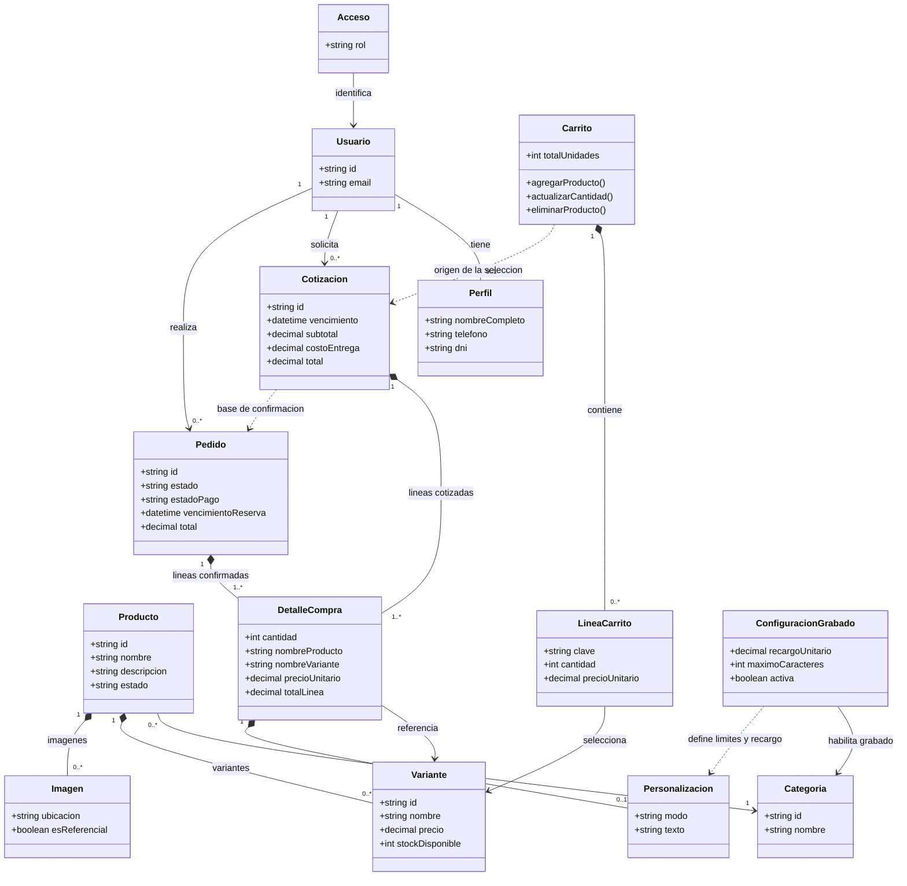

# Diagrama general de clases de Eternal Memory

Vista conceptual unificada basada en develop, commit 9c054bf. Los nombres en español agrupan los tipos del catálogo, los formularios de administración y el checkout; no representan clases instanciables literales.

- El rol de acceso admite usuario o administrador. La administración gestiona productos, variantes, imágenes y configuración del grabado.
- El carrito pertenece al navegador y se conserva en localStorage; no se asocia a la cuenta.
- Cotización y pedido contienen copias independientes de los detalles y la ubicación de entrega. DetalleCompra resume CheckoutQuoteLine; no es una misma instancia compartida entre ambos.
- Los precios, existencias y estados agrupan modelos distintos de lectura y edición. El carrito también admite selecciones heredadas que todavía deben resolver su variante.
- Las relaciones punteadas expresan dependencias del proceso. El diagrama no presupone una relación persistida entre carrito, cotización y pedido ni un pago completado.
