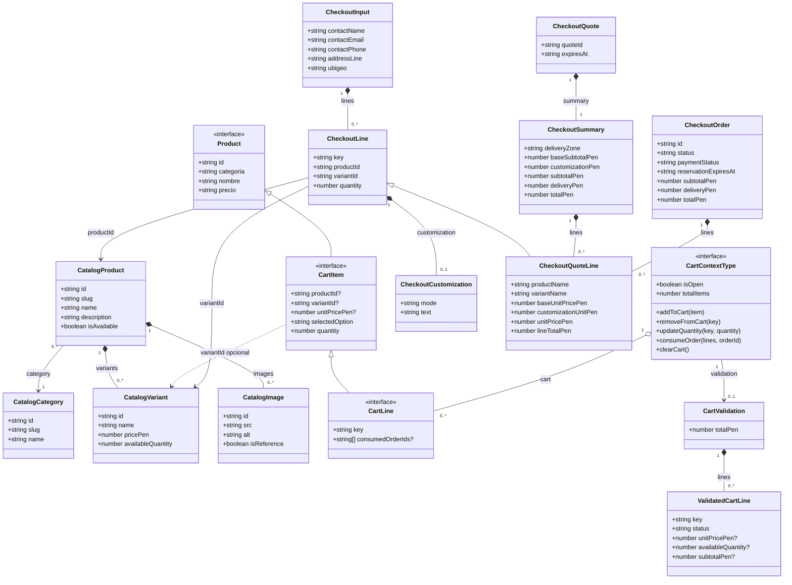
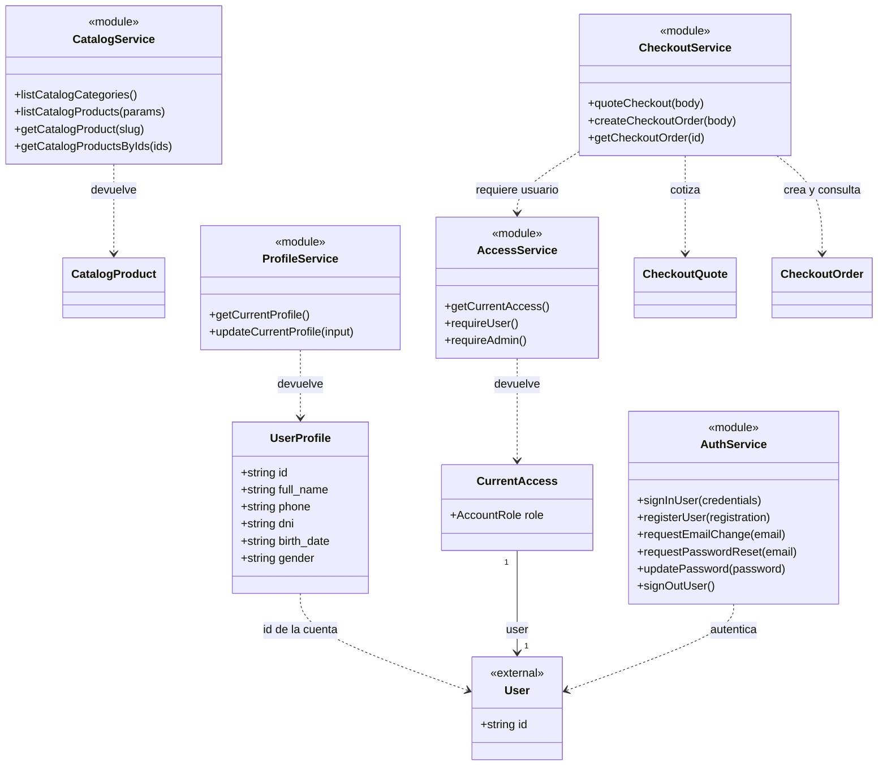
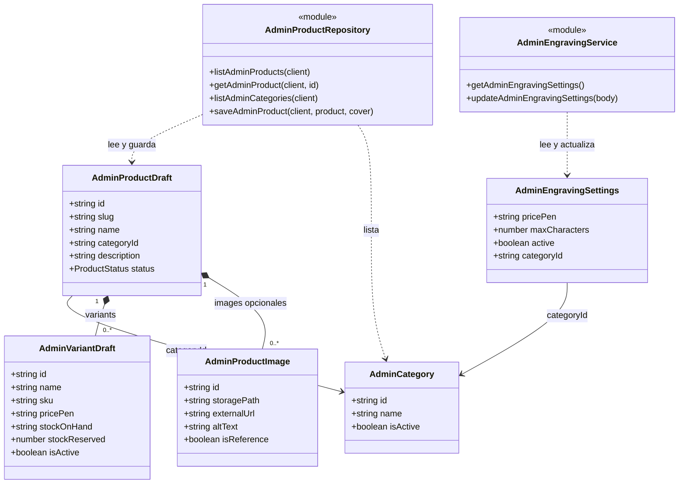

# Diagrama de clases de Eternal Memory

Basado en `develop`, commit `9c054bf`.

El proyecto usa tipos, interfaces, funciones y componentes React. Se utiliza notación de clases UML para representar estas estructuras; los servicios representan módulos de funciones, no clases instanciables. Se muestran los atributos principales, no todos los campos auxiliares ni componentes de interfaz. `?` indica un campo opcional.

## Catálogo, carrito y pedidos

Las multiplicidades de los arreglos expresan sus tipos TypeScript; las validaciones de ejecución pueden exigir líneas o variantes. `CheckoutQuoteLine` amplía `CheckoutLine` mediante una intersección de tipos. `Product` es el modelo de presentación heredado que todavía utiliza el carrito; `CatalogProduct` es el modelo del catálogo actual. No existe herencia entre ambos.

## Cuenta y servicios

`User` pertenece a Supabase Auth. `AccountRole` admite `user` y `admin`; el código verifica el rol, sin una subclase Administrador. Los campos personales del perfil, salvo el nombre, admiten `null`. La pertenencia del pedido a la cuenta se verifica en el servicio mediante `customer_id`, aunque `CheckoutOrder` no expone ese atributo.

## Administración de productos

`ProductStatus` admite `draft`, `published` y `archived`. Los importes y existencias editables de administración son cadenas en los formularios; no tienen el mismo tipo que los valores numéricos del catálogo.

## Fuentes

- `src/features/catalogo/types/catalog.ts`
- `src/features/products/data/productsData.ts`
- `src/features/cart/types/cart.ts`
- `src/features/cart/context/CartContext.tsx`
- `src/features/checkout/types/checkout.ts`
- `src/features/checkout/services/checkoutService.ts`
- `src/features/auth/types/access.ts`
- `src/features/auth/services/accessService.ts`
- `src/features/auth/services/profileService.ts`
- `src/services/authService.ts`
- `src/features/catalogo/services/catalogService.ts`
- `src/features/admin-products/data/adminProducts.ts`
- `src/features/admin-products/data/adminProductRepository.ts`
- `src/features/checkout/services/adminEngravingService.ts`
